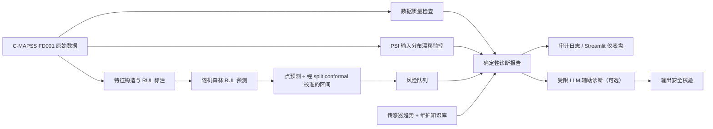

# Industrial Health Agent

[](https://github.com/zzhouxy427/industrial-health-agent/actions/workflows/ci.yml)

基于 NASA C-MAPSS FD001 数据集的工业设备健康诊断 Agent 原型。项目以涡扇发动机为对象，预测剩余寿命（RUL），并将预测不确定性、数据质量、输入分布漂移、传感器趋势、维护知识库、人工复核队列和受限 LLM 辅助诊断整合为可追溯的工作流。

> 仅用于研究和学习。数据集为仿真基准，系统不会执行自动停机、维修或任何安全关键操作。

## 系统能力

- 使用调优后的随机森林回归器预测 RUL，并在官方 FD001 测试集上评估。
- 在本地完整流水线中执行 MAE/RMSE 与人工复核队列召回率门禁，阻止明显性能退化或漏报增加的模型结果被发布。
- 基于随机森林树集合输出 10%–90% 区间，并用训练集独立发动机的 split conformal 校准提升区间可靠性。
- 通过数据质量检查识别缺失、周期重复/间断和超出训练分布范围的输入。
- 以 PSI 监控当前批次输入分布相对训练集的偏移，并将结果纳入诊断结论。
- 通过受控传感器/工况偏置场景压力测试 PSI 监控，不修改原始数据。
- 将设备划分为 `critical`、`review`、`monitor`，生成批量人工复核清单。
- 根据关键传感器趋势和本地维护知识库生成确定性诊断报告。
- 可选调用兼容 OpenAI API 的 LLM；LLM 输出必须通过缺失项与危险指令安全校验。
- 记录诊断审计日志，并以 Streamlit 提供本地可视化界面；首页同时展示模型版本与 MAE/RMSE 发布门禁状态。

完整架构见 [docs/architecture.md](docs/architecture.md)。

## 当前实验结果

| 指标 | 结果 |
| --- | ---: |
| 官方 FD001 测试集 MAE | 19.53 cycles |
| 官方 FD001 测试集 RMSE | 26.10 cycles |
| 5 折发动机级交叉验证 MAE | 26.37 ± 1.64 cycles |
| 5 折发动机级交叉验证 RMSE | 37.57 ± 2.77 cycles |
| 校准后 P10–P90 区间实际覆盖率 | 86.0%（名义约 80%） |
| 留出发动机告警提前量回测 | 19/20 台在临界区前触发复核；中位提前 21.5 cycles |
| 人工复核队列离线召回率 | 93.8%（点预测 `critical` 为 62.5%） |
| 漂移压力测试 | 3 个受控偏置场景均触发 PSI 人工复核提示 |
| 风险阈值 | 20 cycles |

这些数字反映该版本和 FD001 模拟数据上的实验结果，不应外推为真实航空设备性能或安全结论。
完整实验设置、结果来源及解释见 [docs/experiment_report.md](docs/experiment_report.md)，
适用边界见 [docs/limitations.md](docs/limitations.md)。

## 架构概览



## 项目结构

```text
src/
  save_predictions.py           # 训练模型并导出官方测试集预测
  prediction_uncertainty.py     # 树集合预测区间与共形校准工具
  conformal_calibration.py      # 基于独立训练发动机的区间校准
  evaluate_alert_timing.py      # 留出发动机上的人工复核告警提前量回测
  drift_stress_test.py          # 受控输入偏移下的 PSI 监控压力测试
  performance_gate.py           # 基于官方评估 MAE/RMSE 的本地发布门禁
  evaluate_risk_queue.py        # 离线量化风险队列的精确率与召回率
  risk_queue_gate.py            # 检查人工复核队列的离线召回率门禁
  model_artifact.py             # 保存带 SHA-256 指纹的本地模型快照与清单
  release_audit.py              # 汇总性能、队列与快照完整性的本地发布审计
  data_quality.py               # 单台设备数据质量检查
  data_drift.py                 # PSI 特征分布偏移计算
  risk_queue.py                 # critical/review/monitor 优先级
  generate_diagnostic_report.py # 确定性单台诊断报告
  generate_review_summary.py    # 批量人工复核摘要
  llm_agent.py                  # 可选 LLM 调用与安全校验
  dashboard.py                  # Streamlit 本地仪表盘
tests/                           # 自动化测试
docs/                            # 架构、实验与维护知识文档
scripts/run_full_pipeline.ps1   # 一键复现实验流程
```

## 环境准备

需要 Python 3.10+ 与 PowerShell。建议在项目根目录执行：

```powershell
python -m venv .venv
.\.venv\Scripts\Activate.ps1
python -m pip install -r requirements.txt
```

将下列 FD001 文件放到 `data/raw/`，这些原始数据不会提交到 Git：

- `train_FD001.txt`
- `test_FD001.txt`
- `RUL_FD001.txt`

## 一键复现实验

下面命令会完成数据处理、预测导出、官方评估、漂移监控、风险队列、批量复核摘要和自动化测试：

```powershell
powershell -NoProfile -ExecutionPolicy Bypass -File .\scripts\run_full_pipeline.ps1
```

若只想复现数据与报告、不运行测试：

```powershell
powershell -NoProfile -ExecutionPolicy Bypass -File .\scripts\run_full_pipeline.ps1 -SkipTests
```

主要生成物位于被 Git 忽略的 `artifacts/`：

- `fd001_predictions.csv`：官方测试集 RUL 预测和经验区间；
- `prediction_interval_report.md`：经验区间的实际覆盖率和平均宽度；
- `data_drift_report.md`：批次级 PSI 偏移报告；
- `risk_queue.csv`：风险优先级队列；
- `maintenance_review_summary.md`：批量人工复核清单；
- `diagnostic_report_unit_*.md`：单台确定性诊断报告；
- `diagnosis_audit.jsonl`：追加式审计记录。

## 单台诊断与网页

```powershell
python src\agent_cli.py --unit 34
streamlit run src\dashboard.py
```

随后在浏览器打开终端提示的本地地址（通常为 `http://localhost:8501`）。

## 可选：LLM 辅助诊断

复制 `.env.example` 为 `.env`，填写自己的模型服务配置。`.env` 已被 Git 忽略，绝不能提交密钥：

```text
LLM_API_KEY=你的密钥
LLM_BASE_URL=https://你的兼容服务地址/v1
LLM_MODEL=模型名称
```

执行：

```powershell
python src\llm_agent.py --unit 34
```

LLM 只能获得导出的结构化上下文；输出必须提到预测区间、传感器趋势、人工复核和研究用途，并且会拒绝包含自动停机或立即维修等危险命令的内容。

## 演示与项目说明

- [3 分钟演示脚本](docs/demo_walkthrough.md)
- [发布前检查清单](docs/release_checklist.md)
- [系统架构与决策边界](docs/architecture.md)
- [实验结果与复现说明](docs/experiment_report.md)
- [模型卡（用途、指标、风险与发布控制）](docs/model_card.md)
- [时间窗口特征选择实验](docs/temporal_feature_selection.md)
- [当前局限性](docs/limitations.md)

## 参与贡献

欢迎提交可复现、带测试的改进。提交前请阅读 [贡献指南](CONTRIBUTING.md)，尤其注意不得提交 API Key、原始数据和运行产物，也不要让诊断逻辑产生自动停机、维修或其他安全关键指令。

## 已知限制

- 预测区间由树集合分位数经 split conformal 扩张得到；它在 FD001 上有经验覆盖率证据，但**不是对真实设备的严格安全保证**。
- PSI 表示输入分布变化，不等同于预测误差，也不能单独说明模型失效。
- FD001 是仿真数据，真实场景还需考虑数据漂移、工况变化、传感器校准、领域验证和安全认证。
- 当前 LLM 用于解释辅助，不参与自动控制或自动下达维护指令。
