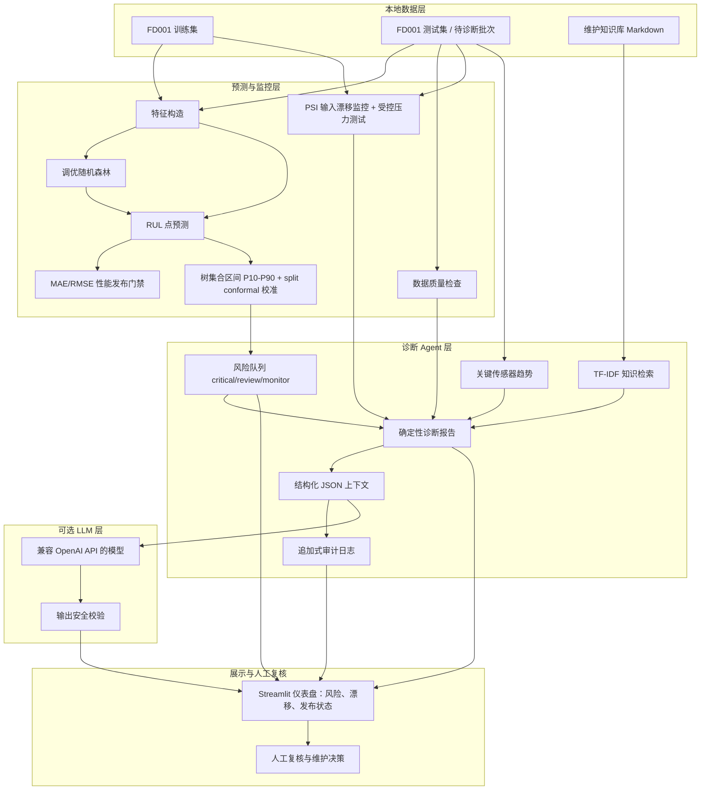

# 系统架构与数据流

## 设计目标

将“RUL 数值预测”扩展为可复核的诊断工作流。模型输出不会直接转为维护指令；每次诊断还要结合预测区间、数据质量、输入分布偏移、传感器趋势和维护知识，并保留审计证据。

## 运行时架构

## 诊断决策边界

| 证据 | 作用 | 不能得出的结论 |
| --- | --- | --- |
| RUL 点预测 | 提供预计剩余周期 | 不保证设备一定在该周期失效 |
| 校准后 P10–P90 区间 | 反映树模型分歧，并基于独立训练发动机做 split conformal 扩张 | 不是对真实设备的安全保证 |
| 风险阈值 | 分配人工复核优先级 | 不是自动停机阈值 |
| 数据质量检查 | 识别缺失、重复、周期间断和异常范围 | 不保证传感器物理正确 |
| PSI 漂移 | 提示输入分布相对训练集变化 | 不单独证明模型失效 |
| LLM 建议 | 帮助总结已提供的证据 | 不产生控制命令或安全关键决定 |

## 核心工作流

1. `save_predictions.py` 用训练集训练随机森林，并以独立训练发动机估计 split conformal 偏移；随后对每台测试发动机最后一个周期导出 RUL 与校准后的 P10/P90。
2. `risk_queue.py` 将点预测低于阈值的设备标为 `critical`，区间下界触及阈值的设备标为 `review`。
3. `evaluate_alert_timing.py` 在独立留出发动机轨迹上回测首次人工复核的提前量，不使用未来周期或官方测试标签。
4. `drift_stress_test.py` 对传感器校准偏置与运行设置偏移进行受控压力测试，验证 PSI 监控的敏感性。
5. `performance_gate.py` 检查官方评估结果是否超过允许的 MAE/RMSE 上限，防止明显回归进入发布结果。
6. `agent_cli.py --unit N` 调用确定性报告、导出结构化上下文，并写入审计日志。
7. 可选的 `llm_agent.py --unit N` 读取上下文并调用外部模型；只有通过安全规则的文本才会保存和展示。
8. `dashboard.py` 用于查看复核队列、单台证据、模型版本与性能门禁、报告、LLM 辅助结果和审计历史。

## 复现入口

运行 [scripts/run_full_pipeline.ps1](../scripts/run_full_pipeline.ps1) 可重新生成项目主要实验产物。详细命令见项目根目录 README。
